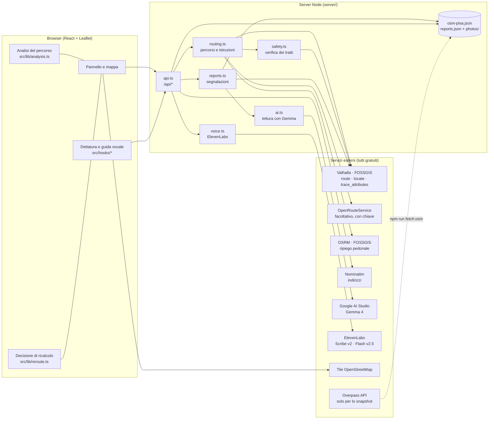

# Architettura di OpenWay

OpenWay è un'app web con due parti nello stesso repository: un'interfaccia React che gira nel browser e un piccolo server Node che tiene le chiavi, parla con i servizi esterni e salva le segnalazioni. Nessun database: per l'hackathon bastano un file JSON e una cartella di foto. In sviluppo le API girano dentro Vite (`vite.config.ts`), in produzione dentro `server/index.ts`: stesso codice (`server/api.ts`), un solo processo.

## Vista d'insieme



Regole che valgono ovunque:

- **Le chiavi stanno solo nel server.** Il browser chiama `/api/*`; `.env` non ha variabili `VITE_`.
- **Niente dati inventati.** Le coordinate di una segnalazione vengono dalla mappa, mai dal testo. L'AI non decide che un ostacolo è verificato e non dichiara un tratto sicuro.
- **Ogni ripiego è dichiarato.** Se un servizio manca o non risponde, la risposta dice cosa è stato usato al suo posto (percorso pedonale, regole a parole chiave, voce disattivata).
- **Mai "accessibile".** L'interfaccia usa "nei dati disponibili", "da controllare", "non verificabile".

## Mappa dei moduli

```
shared/            tipi e regole condivisi tra browser e server
  types.ts         OsmFeature, Report, RouteResult, Interpretation, limiti geografici di Pisa
  rules.ts         soglie in metri e regola "questa segnalazione va evitata?"
  geo.ts           proiezione locale, distanza punto-linea
  navigation.ts    istruzioni di svolta posizionate sulla geometria
server/
  api.ts           handler HTTP /api/* (usato da Vite in dev e da index.ts in produzione)
  routing.ts       Valhalla (3 alternative, istruzioni it-IT, esclusioni), ORS, OSRM, aggancio alla rete (/locate)
  safety.ts        classificazione dei tratti (pedonale, marciapiede, carreggiata, scale) e scelta dell'alternativa
  reports.ts       bozze, creazione, foto, stati; persistenza su file con scritture atomiche
  ai.ts            prompt, chiamata a Gemma (Google o Ollama), validazione del JSON, fallback a regole
  voice.ts         trascrizione e sintesi ElevenLabs con limiti e controlli sul file audio
  osm.ts           query Overpass e classificazione dei tag OSM in "ostacolo noto / possibile / utile / incompleto"
  data/            snapshot OSM (committato), segnalazioni e foto (ignorati da git)
src/
  App.tsx          stato dell'app, calcolo e ricalcolo, orchestrazione dei pannelli
  components/      MapView, RoutePanel, ReportPanel, DetailPanel, MapControls, NavigationPanel, DictationButton
  lib/             analysis (ostacoli lungo il percorso), compare, reroute, alerts, speech, navigation, labels, icons
  hooks/           useDictation, useElevenLabsVoice, useVoiceNavigation
  styles.css       design system dell'app (variabili CSS, vetro, tema chiaro/scuro)
  markers.css      marker della mappa, condivisi tra app e landing
  landing/         landing page (/landing/, landing/index.html): hero con mappa, demo dei percorsi, testi in copy.ts
tests/             Vitest (136 test), senza rete: i servizi esterni sono simulati
scripts/           fetch-osm (snapshot), check-gemma (prova dal vivo dell'AI)
cloud/             edizione pubblicata (Cloudflare Workers + D1): app separata, vedi cloud/README.md
```

## Flusso 1 — Calcolo di un percorso

```mermaid
sequenceDiagram
  participant B as Browser
  participant S as Server (routing.ts + safety.ts)
  participant V as Valhalla
  B->>S: POST /api/route {from, to}
  S->>S: segnalazioni "da evitare" non risolte nella zona → aree escluse (5 m attorno al punto agganciato)
  S->>V: /route pedestrian/wheelchair, alternates=2, language it-IT, exclude_polygons
  V-->>S: fino a 3 percorsi con istruzioni
  loop per ogni percorso
    S->>V: /trace_attributes (tipo di via, marciapiede)
    V-->>S: tratti classificati
  end
  S->>S: scarta strade principali senza marciapiede e scale; preferisce meno carreggiata (max 2 m di deviazione per metro evitato)
  S->>S: verifica sulla geometria che le segnalazioni escluse siano a più di 3 m
  S-->>B: RouteResult {coords, distanza, durata, safety, maneuvers, avoidedBlocking, avoidFailed, notice}
  B->>B: analysis.ts confronta il percorso con i dati OSM e le segnalazioni → punti di attenzione numerati
  B->>S: POST /api/route {profile: foot} (in parallelo, solo per il confronto)
```

Catena dei servizi: OpenRouteService (se c'è la chiave) → Valhalla → OSRM pedonale, dichiarato come *non calcolato per sedia a rotelle*. Un "nessun percorso per sedia a rotelle" è un risultato, non un guasto: non viene sostituito con un percorso a piedi.

## Flusso 2 — Segnalazione e ricalcolo

```mermaid
sequenceDiagram
  participant U as Chi segnala
  participant B as Browser
  participant S as Server
  participant G as Gemma
  participant V as Valhalla
  U->>B: punto sulla mappa + testo (+ foto, anche dettati)
  B->>S: POST /api/reports/draft {description, photo}
  S->>G: prompt + foto → JSON (tipo, riassunto, gravità solo se esplicita, domanda, blocca il passaggio?)
  G-->>S: risposta
  S->>S: validazione dello schema; se non valida o assente → regole a parole chiave, dichiarate
  S-->>B: bozza (draftId + interpretazione)
  U->>B: conferma o corregge tipo, "si passa?", risposta alla domanda
  B->>S: POST /api/reports {draftId, lat, lng, blocking, answer, category}
  S->>V: /locate → punto sulla via più vicina e distanza
  S->>S: impact = avoid | caution | unlocated (shared/rules.ts); stato = "da controllare"
  S-->>B: Report salvato
  B->>B: reroute.ts: l'ostacolo va evitato ed è a ≤ 3 m dal percorso attivo?
  alt sì
    B->>S: POST /api/route (stesso from/to; le risposte superate vengono scartate)
    S-->>B: nuovo percorso
    B->>B: verifica geometrica → "percorso aggiornato" oppure "nessun percorso alternativo"
  else no
    B->>B: "il percorso non cambia" / "ostacolo non localizzato" / "non blocca il passaggio"
  end
```

Regole in `shared/rules.ts` (un solo punto da cambiare):

| Soglia | Valore | Significato |
|---|---|---|
| `SNAP_MAX_M` | 15 m | oltre questa distanza dalla via più vicina l'ostacolo è "non localizzato" |
| `ON_EDGE_M` | 3 m | un ostacolo agganciato alla rete è sul percorso se il percorso passa entro questa distanza (marciapiede e carreggiata paralleli distano 4–10 m) |
| `RAW_NEAR_M` | 15 m | tolleranza quando l'aggancio non è disponibile (si usa il punto toccato) |
| `AVOID_HALF_M` | 5 m | semilato dell'area esclusa dal routing |

`routingImpact(categoria, blocca, distanzaAggancio)`: bloccante (per chi segnala o per l'analisi) o scale → `avoid`; "si passa" detto da chi segnala → sempre `caution`; da evitare ma lontano da ogni via → `unlocated`.

## Flusso 3 — Voce

```mermaid
flowchart LR
  M[Microfono] -->|MediaRecorder, max 30 s / 2 MB| D[useDictation]
  D -->|multipart audio| T[/api/voice/transcribe]
  T -->|controllo formato e dimensione| EL1[ElevenLabs Scribe v2<br/>language ita]
  EL1 -->|testo| D
  D -->|spokenPlaceQuery: "Portami in X" → "X"| R[Ricerca indirizzo / campo descrizione]
  N[useVoiceNavigation<br/>GPS + istruzioni del routing] -->|testo| P[/api/voice/speak]
  P --> EL2[ElevenLabs Flash v2.5<br/>mp3]
  EL2 --> N
```

- Il testo trascritto non avvia mai da solo un'azione irreversibile: la destinazione va scelta dall'elenco, la segnalazione va confermata.
- Le istruzioni lette sono quelle di Valhalla (`language: it-IT`), agganciate agli indici della geometria. Se anche una sola non torna, `maneuvers` è vuoto e la guida resta disattivata.
- La guida avanza con il GPS solo con precisione ≤ 35 m, posizione recente e sul percorso; altrimenti tace e lo dice. Richiede HTTPS o `localhost`.
- Il server limita le chiamate (intervallo minimo e serbatoio per tipo), accetta solo audio reale (controllo dei primi byte), non conserva né audio né trascrizioni.

## Dati OpenStreetMap

`scripts/fetch-osm.ts` interroga Overpass una volta sull'area demo e salva `server/data/osm-pisa.json`. `server/osm.ts` traduce i tag in un modello unico:

| Certezza | Esempi di tag | Uso |
|---|---|---|
| ostacolo noto | `highway=steps`, `kerb=raised`, `wheelchair=no`, `width<0.9` | elenco "Lungo il percorso", evidenza sulla mappa |
| possibile difficoltà | `surface=sett`, `smoothness=bad`, `incline>6%`, `barrier=bollard` | "Più dettagli", mappa da vicino |
| elemento utile | `kerb=lowered`, `wheelchair=yes` | confronto, mappa da vicino |
| informazioni mancanti | attraversamento senza `kerb` | "attraversamenti senza informazioni" |

L'accessibilità dei luoghi (`wheelchair=*` su negozi ed edifici) è un livello a parte e non conta come ostacolo sul percorso.

## Design system

`src/styles.css` definisce tutto con variabili CSS: colori (tema chiaro e scuro automatici), superfici di vetro (`backdrop-filter` con superficie piena come ripiego), raggi, spazi, tipografia (Atkinson Hyperlegible Next). I colori dei marker vengono dalla palette Okabe-Ito, leggibile con deficit cromatici, e ogni stato ha anche una forma o un'icona: mai solo il colore. Le tile OpenStreetMap sono desaturate via CSS, così percorso e ostacoli restano gli unici elementi colorati.

## Test e verifica

- `npm test`: 136 test Vitest senza rete (servizi esterni simulati). Coprono classificazione OSM, analisi del percorso, routing sicuro e i 7 scenari di ricalcolo, regole, AI e fallback, voce, API.
- Prove dal vivo (non automatizzate nel repository): `npm run check:ai` per Gemma; script Playwright con microfono simulato per dettatura e guida vocale; i cinque percorsi demo del README.
- Edizione `cloud/`: test propri (`cd cloud && npm test`), vedi `cloud/README.md`.
