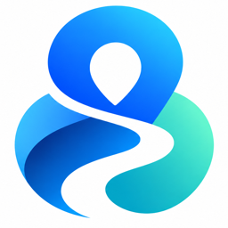

# OpenWay — Freedom to move



OpenWay aiuta chi si muove in sedia a rotelle a orientarsi a Pisa. Calcola un percorso adatto, lo confronta con i dati di accessibilità di OpenStreetMap e con le segnalazioni degli utenti, e dice chiaramente **cosa si sa, cosa è solo probabile e cosa manca**. Si usa con la mappa, con le dita o con la voce.

> OpenWay non dichiara mai un percorso "accessibile" o "sicuro". Mostra quello che i dati permettono di verificare: l'assenza di ostacoli noti non è una garanzia e nessun percorso è stato controllato di persona.

Prototipo nato per un hackathon (ottobre 2026). Il progetto si chiamava *AccessGo*: il documento di partenza `AccessGo.md` e il repository GitHub conservano il vecchio nome. L'edizione pubblicata su https://accessogo.xyxzwb.chatgpt.site/ vive nella cartella [`cloud/`](cloud/README.md) ed è un'app separata. L'architettura è descritta in [ARCHITECTURE.md](ARCHITECTURE.md).

---

## Cosa fa

| Funzione | In breve |
|---|---|
| **Percorso per sedia a rotelle** | Calcolato gratis con Valhalla (profilo `wheelchair`) o con OpenRouteService se si configura la chiave. Fino a 3 alternative, verificate tratto per tratto: si scartano strade trafficate senza marciapiede e scale. |
| **Punti di attenzione** | Ostacoli noti di OpenStreetMap (scale, marciapiedi senza scivolo, passaggi stretti…), segnalazioni degli utenti e tratti in strada senza marciapiede, numerati nell'ordine in cui si incontrano, sul pannello e sulla mappa. |
| **Confronto con il percorso a piedi** | Stesso motore, due profili: si vede cosa evita il percorso per sedia a rotelle e quanto costa in metri. |
| **Segnalazioni** | Posizione scelta sulla mappa (o GPS), testo, foto facoltativa. Gemma legge la descrizione, propone tipo e gravità, fa una domanda mirata e dice se l'ostacolo blocca il passaggio. Chi segnala conferma o corregge. |
| **Ricalcolo automatico** | Se la segnalazione blocca il passaggio ed è davvero sul percorso attivo, il percorso viene ricalcolato evitandola e l'app verifica sulla geometria che la eviti davvero. |
| **Voce (ElevenLabs)** | Dettatura di partenza, arrivo e descrizione delle segnalazioni; guida vocale che legge le istruzioni di svolta in italiano, con avanzamento GPS. |
| **Stati chiari** | Ogni segnalazione nasce "da controllare". Solo un moderatore può segnarla come controllata o risolta. |

Tutto funziona anche senza chiavi: in quel caso la lettura delle segnalazioni usa regole a parole chiave (dichiarate come "senza intelligenza artificiale") e la voce è disattivata.

---

## Installazione

Requisiti: **Node.js 23.6 o più recente** (il server è TypeScript eseguito direttamente da Node). Testato con Node 26 su macOS.

```bash
git clone https://github.com/gixrda/accessgo.git
cd accessgo
npm install
cp .env.example .env        # facoltativo: senza chiavi funziona lo stesso, con i fallback dichiarati
npm run dev                 # apri http://localhost:5173
```

Per provarla dal telefono sulla stessa rete Wi‑Fi:

```bash
npm run dev -- --host       # apri dal telefono l'indirizzo "Network" stampato, es. http://172.20.10.2:5173
```

Dal telefono via `http://` funzionano mappa, percorsi e segnalazioni. **GPS e microfono no**: i browser li concedono solo su `https://` o `localhost`. Per quelli usa l'edizione `cloud/` pubblicata in HTTPS.

Versione di produzione (un solo processo Node che serve API e interfaccia):

```bash
npm run build
npm start                   # http://localhost:8787
```

### Chiavi (`.env`)

Tutte le chiavi sono lette **solo dal server**: non hanno prefisso `VITE_` e non finiscono nel browser. Nessuna è obbligatoria.

| Variabile | Serve per | Dove si ottiene | Senza |
|---|---|---|---|
| `GEMINI_API_KEY` | Lettura delle segnalazioni con **Gemma 4** (`GEMMA_MODEL`, default `gemma-4-26b-a4b-it`) | [Google AI Studio](https://aistudio.google.com/apikey), gratis | regole a parole chiave, dichiarate |
| `ELEVENLABS_API_KEY` | Dettatura e guida vocale (`ELEVENLABS_VOICE_ID`, `ELEVENLABS_TTS_MODEL` facoltativi) | [ElevenLabs](https://elevenlabs.io/), piano gratuito; basta una chiave con i soli permessi *text to speech* e *speech to text* | voce disattivata, tutto il resto funziona |
| `ORS_API_KEY` | Routing OpenRouteService (considera anche i cordoli) | [openrouteservice.org](https://openrouteservice.org/dev/#/signup), gratis | Valhalla (gratis, senza chiave) |
| `OLLAMA_URL`, `OLLAMA_MODEL` | Gemma in locale con Ollama, al posto di Google | `ollama pull gemma3` | — |
| `ADMIN_TOKEN` | Codice per cambiare lo stato delle segnalazioni (`demo-admin` nel file di esempio) | lo scegli tu | cambio stato disabilitato |
| `PORT` | Porta di `npm start` (default 8787) | — | — |

---

## Come si usa

### Trovare un percorso
1. **Partenza**: scrivi un indirizzo e premi *Cerca*, oppure *Scegli sulla mappa*, oppure *La mia posizione*, oppure *Detta partenza* e parla.
2. **Arrivo**: stesso procedimento. Se detti "Portami in Piazza dei Cavalieri", l'app cerca "Piazza dei Cavalieri" e ti mostra i risultati: scegli quello giusto.
3. **Calcola percorso**. In cima al pannello compare l'esito in una frase, *"Nessun ostacolo noto"* oppure *"3 punti di attenzione"*, con distanza e durata.
4. **Lungo il percorso** elenca i punti di attenzione nell'ordine in cui li incontri, con la distanza dalla partenza. Toccane uno per vederlo sulla mappa e leggere i dati di OpenStreetMap.
5. **Più dettagli** (chiuso di default): su che tipo di strada passi, confronto con il percorso a piedi, difficoltà minori, fonti.

Se il percorso passa su strade senza marciapiede mappato, l'app lo dice: *"Non è stato possibile trovare un percorso sufficientemente verificabile. Controlla la mappa prima di proseguire."* e evidenzia i tratti in ambra.

### Guida vocale
Con un percorso calcolato e la voce attiva compare **Guida vocale**:
- *Prova voce ElevenLabs* e *Ascolta prossima indicazione* fanno sentire la voce senza GPS.
- *Avvia guida vocale* usa il GPS: annuncia le svolte in anticipo e si ferma da sola se la posizione è imprecisa o fuori percorso. Serve HTTPS (o `localhost`) e la pagina deve restare aperta.
- Le indicazioni sono quelle reali del servizio di routing, in italiano; se non sono coerenti con la geometria del percorso la guida resta disattivata invece di inventare.

### Segnalare un ostacolo
1. **Segnala un ostacolo** → tocca il punto esatto sulla mappa (o *La mia posizione*).
2. Descrivi cosa hai trovato, scrivendo o con *Detta la descrizione*. Puoi aggiungere una foto (ridimensionata nel browser, senza dati GPS).
3. **Continua**: l'app mostra "Abbiamo capito così" (tipo, riassunto, cosa si vede nella foto), chiede *Si riesce a passare con la sedia a rotelle?* e una domanda mirata, per esempio quanto è alto il gradino. Correggi quello che vuoi.
4. **Invia segnalazione**. Compare sulla mappa con il "?" di *da controllare*; se blocca il passaggio ha il segnaposto rosso.
5. Se avevi un percorso attivo e l'ostacolo è davvero su quel percorso, viene ricalcolato: *"Ostacolo rilevato: percorso aggiornato"*. Altrimenti l'app spiega perché non cambia: ostacolo su un'altra via, non bloccante, troppo lontano da ogni strada, nessuna alternativa, servizio non disponibile.

### Moderare
Apri una segnalazione → *Azioni moderatore* → inserisci `ADMIN_TOKEN` → *Controllata sul posto* o *Risolta*. Una segnalazione risolta non viene più evitata dai percorsi.

### Legenda della mappa
Il bottone con i livelli (in alto a destra) accende e spegne ostacoli noti, segnalazioni, possibili difficoltà, elementi utili, attraversamenti senza informazioni e accessibilità dei negozi. Da lontano si vedono solo ostacoli noti e segnalazioni; avvicinando compare il resto. Il riquadro tratteggiato è la zona coperta dai dati (zona universitaria).

---

## Percorsi per la demo

Link con partenza e arrivo precompilati, verificati il 24/10/2026. Gli ostacoli sono quelli mappati in OpenStreetMap, non controllati sul posto.

| Scenario | Link | Cosa mostra |
|---|---|---|
| Via Roma | [`/?from=43.71696,10.39513&to=43.71856,10.39513`](http://localhost:5173/?from=43.71696,10.39513&to=43.71856,10.39513) | tutto pedonale, ma 3 marciapiedi senza scivolo |
| Lungarno Mediceo | [`/?from=43.715316,10.406241&to=43.716072,10.406693`](http://localhost:5173/?from=43.715316,10.406241&to=43.716072,10.406693) | a piedi si passa da una scala; in sedia a rotelle la si evita |
| Via Santa Maria | [`/?from=43.71823,10.39744&to=43.71983,10.39744`](http://localhost:5173/?from=43.71823,10.39744&to=43.71983,10.39744) | 210 m in strada senza marciapiede: percorso non verificabile |
| Via del Galloro | [`/?from=43.71400,10.39565&to=43.71560,10.39565`](http://localhost:5173/?from=43.71400,10.39565&to=43.71560,10.39565) | 3 marciapiedi senza scivolo + 60 m in strada |
| Piazza Sant'Antonio | [`/?from=43.71243,10.39733&to=43.71243,10.39953`](http://localhost:5173/?from=43.71243,10.39733&to=43.71243,10.39953) | scelta un'alternativa più lunga di 190 m per evitare 120 m in strada e 2 ostacoli |

Demo in 3 minuti: link 5 (spiega la scelta) → link 3 (limite dichiarato) → link 1 (ostacoli numerati) → *Segnala un ostacolo* sul percorso 1, detta *"Transenne del cantiere sul marciapiede: non riesco a passare"* → *Continua* → *Invia* → il percorso si aggiorna → *Prova voce* nella guida vocale.

---

## Comandi

| Comando | Cosa fa |
|---|---|
| `npm run dev` | Vite + API nello stesso processo (`-- --host` per la rete locale) |
| `npm run build` | type-check (`tsc -b`) e build del frontend in `dist/` |
| `npm start` | server Node di produzione: API + `dist/` |
| `npm test` | 136 test Vitest (dati OSM, analisi e confronto percorsi, routing sicuro, ricalcolo, AI e fallback, voce, API) |
| `npm run typecheck` | solo type-check |
| `npm run check:ai` | prova dal vivo di Gemma su segnalazioni di esempio (richiede la chiave) |
| `npm run fetch:osm` | riscarica lo snapshot OpenStreetMap della zona (una sola richiesta a Overpass) |

Lint non configurato (scelta per ridurre le dipendenze); TypeScript in modalità `strict`.

---

## Dati e servizi

- **OpenStreetMap** (© OpenStreetMap contributors, ODbL): snapshot del 24/10/2026 in `server/data/osm-pisa.json`, 1158 elementi della zona universitaria (55 ostacoli noti, 398 possibili difficoltà, 105 elementi utili, 600 dati descrittivi). Nessun dato inventato. Le tile della mappa sono quelle di OpenStreetMap, desaturate via CSS.
- **Valhalla** (istanza pubblica FOSSGIS): percorsi, istruzioni di svolta, aggancio delle segnalazioni alla rete pedonale. **Nominatim**: ricerca indirizzi (1 richiesta al secondo, limitata a Pisa). **OSRM** (FOSSGIS): ripiego pedonale, dichiarato.
- **Gemma 4** via Google AI Studio: lettura delle segnalazioni, risposta in JSON validata lato server.
- **ElevenLabs**: Scribe v2 (trascrizione) e Flash v2.5 (sintesi), solo tramite il server. Nessun audio o trascrizione viene conservato.

Le segnalazioni sono salvate in `server/data/reports.json` e le foto in `server/data/photos/` (entrambi ignorati da git).

---

## Limiti noti

- I servizi esterni sono istanze pubbliche gratuite, a uso moderato e senza garanzie: per un servizio reale vanno ospitati in proprio (sono tutti open source tranne Gemma via API ed ElevenLabs).
- Valhalla non conosce l'altezza dei cordoli: per questo l'app elenca gli attraversamenti senza informazioni sullo scivolo. Molte vie del centro non hanno il marciapiede mappato in OpenStreetMap e risultano "in strada" anche se il marciapiede esiste.
- Le segnalazioni non sono verificate: quelle bloccanti vengono evitate per prudenza, e una segnalazione sbagliata può allungare un percorso finché un moderatore non la segna come risolta.
- La guida vocale funziona solo con la pagina aperta e lo schermo acceso e non ricalcola da sola se esci dal percorso. È stata verificata nel browser con un microfono simulato e audio sintetico, non camminando con un telefono reale.
- OpenRouteService e Ollama sono coperti dai test con risposte simulate ma non provati contro i servizi reali.
- Persistenza su file: adatta a una demo, non a più istanze o a molti utenti. Nessuna autenticazione, un solo codice moderatore condiviso.
- Solo Pisa, zona universitaria.

## Licenze e attribuzioni

Dati mappa © OpenStreetMap contributors (ODbL). Routing: Valhalla e OSRM (FOSSGIS e.V.). Carattere: Atkinson Hyperlegible Next (Braille Institute, OFL). La voce ElevenLabs su piano gratuito è utilizzabile a scopo non commerciale con attribuzione.
